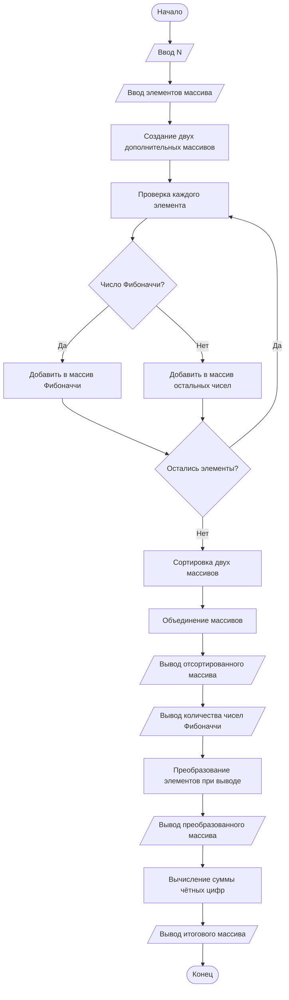

## Отчет по лабораторной работе № 2

#### № группы: `ПМ-2601`

#### Выполнила: `Резниченко Полина Вячеславовна`

#### Вариант: `20`

### Cодержание:

- [Постановка задачи](#1-постановка-задачи)
- [Входные и выходные данные](#2-входные-и-выходные-данные)
- [Математическая модель](#25-математическая-модель)
- [Выбор структуры данных](#3-выбор-структуры-данных)
- [Алгоритм](#4-алгоритм)
- [Программа](#5-программа)
- [Анализ правильности решения](#6-анализ-правильности-решения)
  
### 1. Постановка задачи
Необходимо написать программу на языке Java, которая выполняет обработку одномерного массива натуральных чисел. Программа считывает с консоли число N, затем N целых чисел и заполняет массив размером N, размещает числа в массиве таким образом, чтобы числа, являющиеся числами Фибоначчи, находились в начале массива в порядке возрастания, а остальные числа — в конце массива в порядке убывания. Находит и выводит количество чисел Фибоначчи в массиве. Выводит элементы массива, заменяя числа Фибоначчи на порядковый номер в последовательности, а остальные числа — на −1. Заменяет каждое число в массиве на сумму его чётных цифр и выводит полученный массив.

Числами Фибоначчи будем считать числа последовательности:
`1, 1, 2, 3, 5, 8, 13, 21, 34, 55, ...`

Порядковые номера начинаются с **единицы**. Поскольку число 1 встречается дважды, для него используется номер первого вхождения — 1.

Задачу можно разделить на несколько подзадач:

- проверка принадлежности числа последовательности Фибоначчи;
- разделение элементов на две группы;
- сортировка каждой группы;
- подсчёт количества чисел Фибоначчи;
- преобразование элементов в соответствии с их принадлежностью к последовательности;
- вычисление суммы чётных цифр каждого числа.

### 2. Входные и выходные данные

#### Входные данные

Программа получает с консоли следующие данные:

- N — количество элементов массива;
- N натуральных чисел, которые необходимо поместить в массив.
 Будем считать, что N — целое неотрицательное число, не превышающее 100000, а каждый элемент массива — натуральное число, не превышающее 2147483647.

|   Переменная   | Тип    Java   | min значение | max значение   |
|----------------|---------------|--------------|----------------|
|         N      |        int    | 0            | 10<sup>5</sup> |
|Элементы массива|     int       | 1            | 10<sup>9</sup> |


#### Выходные данные

Программа выводит:

1. Массив после перестановки элементов.
2. Количество чисел Фибоначчи.
3. Массив, в котором числа Фибоначчи заменены их порядковыми номерами, а остальные элементы — числом -1.
4. Массив, в котором каждый элемент заменён суммой его чётных цифр.

Все результаты выводятся в консоль.

### 3. Математическая модель

Последовательность Фибоначчи задаётся следующим образом:

F1 = 1;

F2 = 1;

Fk = F(k-1) + F(k-2) при k >= 3.

Для определения принадлежности числа последовательности используется последовательная генерация чисел Фибоначчи до тех пор, пока очередное число не станет больше либо равно проверяемому.

Если очередное число совпадает с проверяемым, оно является числом Фибоначчи. В противном случае число не принадлежит последовательности.

Для каждого элемента массива определяются две группы:

A — числа Фибоначчи;

B — числа, не являющиеся числами Фибоначчи.

После сортировки получаем:

элементы группы A располагаются по возрастанию;

элементы группы B располагаются по убыванию.

Количество чисел Фибоначчи равно размеру группы A.

При преобразовании элементов используется функция:

G(x) = k, если x = Fk, иначе G(x) = -1.

Для получения суммы чётных цифр числа используется последовательное выделение последней цифры:

digit = x % 10

Если digit % 2 == 0, цифра добавляется к сумме.

После этого число уменьшается в десять раз с помощью целочисленного деления:

`x = x / 10`

Процесс повторяется до тех пор, пока число не станет равным нулю.

4. Выбор структуры данных

Для решения задачи используются одномерные массивы целых чисел типа int.

|Название|Тип|Назначение|
|--------|---|----------|
|numbers|int[]|Основной массив|
|fibonacciNumbers|int[]|Хранение чисел Фибоначчи|
|otherNumbers|int[]|Хранение остальных чисел|
|fibonacciCount|int|Количество чисел Фибоначчи|
|otherCount|int|Количество остальных чисел|
|N|int|Размер исходного массива|

Для сортировки используется встроенный метод `Arrays.sort()`.

Для проверки чисел Фибоначчи и вычисления суммы чётных цифр используются отдельные методы.

Использование отдельных массивов позволяет разделить исходные элементы на две группы, независимо отсортировать их и затем объединить в требуемом порядке.

Для вычислений последовательности Фибоначчи применяется тип long, чтобы избежать переполнения при сложении чисел, превышающих диапазон int.

### 5. Алгоритм

#### Алгоритм выполнения программы

1. Начало программы.

2.Считать размер массива N.

3.Проверить корректность размера массива.

4.Создать основной массив размером N.

5.Считать N натуральных чисел.

6.Создать два дополнительных массива:
- для чисел Фибоначчи;
- для остальных чисел.
  
7.Для каждого элемента исходного массива:
- проверить, является ли он числом Фибоначчи;
- если является, поместить его в первый массив;
- иначе поместить его во второй массив.

8.Отсортировать массив чисел Фибоначчи по возрастанию.

9.Отсортировать массив остальных чисел по возрастанию, после чего разместить их в обратном порядке.

10.Объединить оба массива в основной массив.

11.Вывести полученный массив.

12.Вывести количество чисел Фибоначчи.

13.Для каждого элемента основного массива:
- определить его порядковый номер в последовательности Фибоначчи;
- если число не является числом Фибоначчи, заменить его при выводе на -1.

14.Для каждого элемента основного массива вычислить сумму его чётных цифр.

15.Вывести полученный массив.

16.Конец программы.

#### Блок-схема



### 6. Программа
```java
import java.io.PrintStream;
import java.util.Scanner;
import java.util.Arrays;
public class Main {
    // Проверка полного квадрата.
    static boolean isSquare(long n) {
        long x = (long) Math.sqrt(n);
        return x * x == n;
    }
    // Математическая проверка числа Фибоначчи.
    static boolean isFibonacci(int n) {
        if (n <= 0) return false;
        long x = 5L * n * n;
        return isSquare(x + 4) || isSquare(x - 4);
    }
    // Нахождение порядкового номера числа Фибоначчи.
    static int fibonacciIndex(int n) {
        int a = 1, b = 1, index = 2;
        if (n == 1) return 1;
        while (b < n) {
            int c = a + b;
            a = b;
            b = c;
            index++;
        }
        return b == n ? index : -1;
    }
    // Сумма чётных цифр.
    static int evenDigitsSum(int n) {
        int sum = 0;
        while (n > 0) {
            int digit = n % 10;

            if (digit % 2 == 0)
                sum += digit;
            n /= 10;
        }
        return sum;
    }
    public static void main(String[] args) {
        Scanner sc = new Scanner(System.in);
        // Ввод размера массива.
        System.out.print("Введите количество чисел: ");
        int n = sc.nextInt();
        if (n < 0 || n > 100000) {
            System.out.println("Некорректный размер массива.");
            sc.close();
            return;
        }
        // Создание массива.
        int[] a = new int[n];
        // Заполнение массива с клавиатуры.
        System.out.println("Введите элементы массива:");
        for (int i = 0; i < n; i++) {
            a[i] = sc.nextInt();
            if (a[i] <= 0) {
                System.out.println("Числа должны быть натуральными.");
                sc.close();
                return;
            }
        }
        // Массивы для разделения чисел.
        int[] fib = new int[n];
        int[] other = new int[n];
        int f = 0, o = 0;
        // Разделение чисел.
        for (int x : a) {
            if (isFibonacci(x))
                fib[f++] = x;
            else
                other[o++] = x;
        }
        // Сортировка.
        Arrays.sort(fib, 0, f);
        Arrays.sort(other, 0, o);
        // Объединение массивов.
        for (int i = 0; i < f; i++)
            a[i] = fib[i];
        for (int i = 0; i < o; i++)
            a[f + i] = other[o - 1 - i];
        System.out.println("Отсортированный массив:");
        System.out.println(Arrays.toString(a));
        // Количество чисел Фибоначчи.
        System.out.println("Количество чисел Фибоначчи: " + f);
        // Замена на порядковые номера.
        System.out.println("Преобразованный массив:");
        for (int x : a)
            System.out.print(fibonacciIndex(x) + " ");
        // Замена чисел суммой чётных цифр.
        for (int i = 0; i < n; i++)
            a[i] = evenDigitsSum(a[i]);
        System.out.println("\nСуммы четных цифр:");
        System.out.println(Arrays.toString(a));
        sc.close();
    }
}
```

### 7. Анализ правильности решения

#### Проверим программу на нескольких тестах, охватывающих основные случаи.

Тест 1. Обычный набор чисел

Проверяется правильность разделения элементов, сортировки и преобразования.

**Input**:

```
7

8 4 1 13 2 7 5
```

**Output**:

Отсортированный массив:
```
1 2 5 8 13 7 4
```
Количество чисел Фибоначчи:
```
5
```

Преобразованный массив:
```
1 3 5 6 7 -1 -1
```

Суммы четных цифр:
```
0 2 0 8 2 0 4
```

Тест 2. Все числа являются числами Фибоначчи

Проверяется случай, когда вторая группа элементов пуста.

**Input**:

```
5
13 1 8 2 5
```

**Output**:

Отсортированный массив:
```
1 2 5 8 13
```

Количество чисел Фибоначчи: 
```
5
```
Преобразованный массив:
```
1 3 5 6 7
```

Суммы четных цифр:
```
0 2 0 8 2
```

Тест 3. Ни одно число не является числом Фибоначчи

Проверяется случай, когда первая группа элементов пуста.

**Input**:

```
5
4 6 7 9 10
```

**Output**:

Отсортированный массив:
```
10 9 7 6 4
```

Количество чисел Фибоначчи: 
```
0
```

Преобразованный массив:
```
-1 -1 -1 -1 -1
```

Суммы четных цифр:
```
0 0 0 6 4
```

Тест 4. Массив из одного элемента

Проверяется обработка массива минимального ненулевого размера.

**Input**:

```
1
21
```

**Output**:

Отсортированный массив:
```
21
```
Количество чисел Фибоначчи: 
```
1
```
Преобразованный массив:
```
8
```
Суммы четных цифр:
```
2
```

Тест 5. Повторяющиеся элементы

Проверяется правильность обработки одинаковых чисел.

**Input**:

```
6
3 3 4 4 2 2
```

**Output**:

Отсортированный массив:
```
2 2 3 3 4 4
```
Количество чисел Фибоначчи: 
```
4
```
Преобразованный массив:
```
3 3 4 4 -1 -1
```
Суммы четных цифр:
```
2 2 0 0 4 4
```

Тест 6. Пустой массив

Проверяется обработка нулевого размера массива.

**Input**:

```
0
```

**Output**:

Отсортированный массив:
```

```

Количество чисел Фибоначчи: 
```
0
```
Преобразованный массив:
```

```
Суммы четных цифр:
```

```

### Вывод

В ходе лабораторной работы была разработана программа на языке Java для обработки одномерного массива натуральных чисел.

Программа выполняет разделение элементов на числа Фибоначчи и остальные числа, сортирует полученные группы в требуемом порядке, подсчитывает количество чисел Фибоначчи и выполняет необходимые преобразования элементов массива.

Проведённые тесты подтверждают корректность работы программы на различных наборах данных, включая массив из одного элемента, пустой массив, повторяющиеся числа, а также случаи, когда все или ни одно из чисел не являются числами Фибоначчи.
